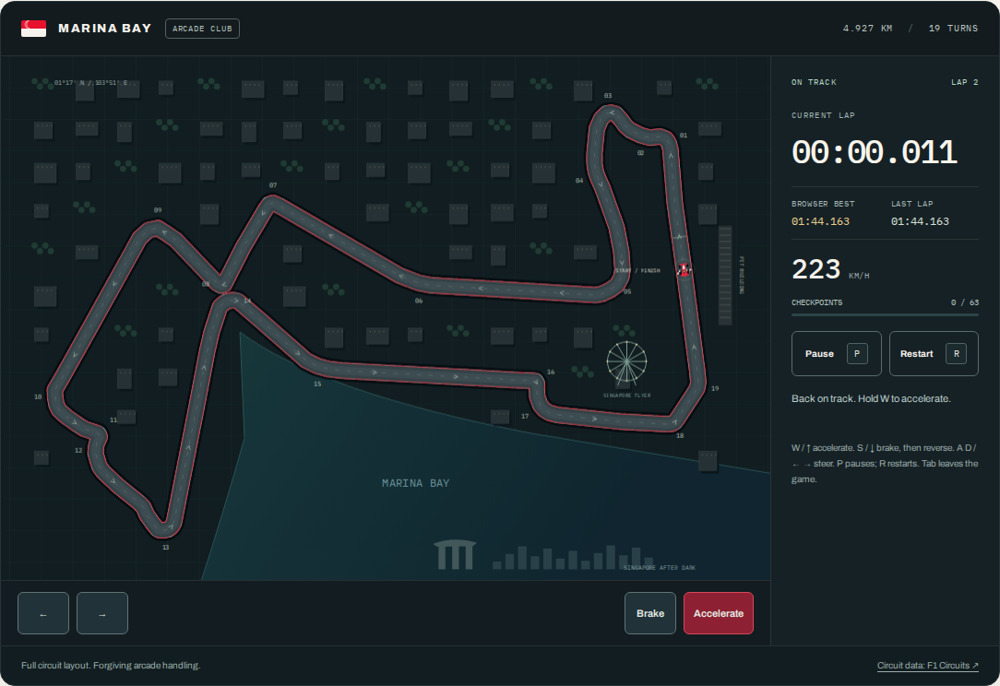

# Marina Bay mini racer: implementation plan and record

## 1. Purpose and current status

Build a compact, playable racing feature for [jarrodlow.com](https://jarrodlow.com) that fits the existing portfolio and preserves the complete Singapore Grand Prix circuit layout.
The presentation is a fixed top-down view with forgiving arcade handling, keyboard controls and touch buttons.
Visitors should understand the controls, start driving and attempt a timed lap without an account or a separate application.

- Planning date: 17 November 2026, Singapore time.
- Repository baseline supplied for this work: `3885f74`.
- Existing stack: React 19, TypeScript 6 and Vite 8; Node.js 24 or newer.
- Existing deployment: GitHub Pages, built and published through `.github/workflows/deploy.yml`.
- Source assessment and architecture selection: complete.
- Implementation: complete in `src/features/marina-bay/`, including the full-route preview, lazy-loaded game, controls, scoring and local persistence.
- Geometry review: complete against the retained upstream GeoJSON and FIA 2025 circuit map. All 116 coordinates, including closure, are retained.
- Automated validation: 81 unit/regression checks and five Chromium browser scenarios pass. The browser checks cover the production build, desktop controls and phone touch emulation, with a separate development-mode complete-lap and persistence check. See section 15 for evidence and limits.

## 2. Product scope

The first version contains one car, the full current Marina Bay route, lap timing and a best lap saved in the visitor's browser.
Use an embedded section that matches the site's motorsport typography, colours and spacing, with a deliberate start action.
The entire circuit remains visible within a fixed camera; scale the view uniformly to fit its container.
The car must steer through the course under player control, with acceleration, braking and meaningful consequences for leaving the road.

- Preserve all 19 turns in their correct order and the circuit's complete geographic shape.
- Retain every supplied route coordinate; use the complete loop for drawing, progress tracking and checkpoints.
- Permit wider drawn road surfaces, larger kerbs and an oversized car to improve readability and handling.
- Provide WASD and arrow-key controls, touch controls, pause/resume, restart and a clear lap result.
- Show speed, current lap time, checkpoint progress and the saved best when one exists.
- Keep the portfolio navigable before, during and after a driving session.
- Keep the first version single-player, locally scored and statically hosted.

Detailed city scenery, opponent cars, multiplayer, a global leaderboard, vehicle upgrades, damage simulation and additional circuits are outside this version.
The visual treatment should communicate a Singapore night race through colour, track lighting accents and restrained surrounding detail.
Any decorative labels or scenery must leave the road, car and tight corner sequences legible.

## 3. Circuit provenance and accuracy

The original source is retained at `public/assets/marina-bay/marina-bay-source.geojson`, with its complete MIT notice at `public/assets/marina-bay/LICENSE.txt`.
`src/features/marina-bay/track-data.ts` contains all 116 projected coordinates, including the repeated closing point, and 19 approximate turn anchors.
Its source is Tomislav Bacinger's MIT-licensed `f1-circuits` data, pinned to a known repository commit.
The source filename `sg-2008.geojson` is an identifier; the inspected geometry represents the post-2023 route and must be evaluated by its actual shape.

| Property | Value or treatment |
| --- | --- |
| Official current circuit length | 4,927 m |
| Community polyline length | Approximately 4,948.18 m under the local projection |
| Difference from official measured length | Approximately 21.18 m, or 0.43% |
| Game distance | 4,927 m, obtained by applying one uniform scale to the entire source polyline |
| Retained vertices | All 116, including the duplicate endpoint that closes the loop |
| Turn count | 19 |
| Race direction | Anti-clockwise; source coordinate order was reversed during preparation |
| Projection | Local approximate metres, east as positive x and south as positive y |
| Arcade road width | 32 game metres, from `ROAD_HALF_WIDTH = 16`; a gameplay choice rather than measured street width |
| Start/finish | Approximate location on the main straight, not a surveyed timing line |
| Turn anchors | Matched visually to the FIA circuit map; approximate rather than surveyed apexes |

The full geographic route and its proportions are retained. Both axes receive the same length-normalisation factor in `track.ts`, followed by the same responsive drawing scale in `renderer.ts`.
The source order is reversed while keeping the main-straight reference as the start; the first movement is north toward Turn 1.
The renderer draws the complete polyline with rounded stroke joins. No sections, vertices or chicanes are removed, and the course is not shortened into a fictional loop.
The source data and the turn labels are approximate. Scaling the trace to 4,927 m makes game distances consistent with the official reference; it does not make the trace survey-accurate.
Turns 11 and 12 retain their short sequence before the Turn 13 hairpin. Their reviewed anchors correspond to upstream source vertices 55, 52 and 40, respectively.
If smoothing is added later, verify that it neither cuts out a chicane nor joins nearby sections of road; the retained source route remains authoritative for game progress.
Road width, car scale, kerbs, driving speeds and lap times are gameplay choices, not claims of real-world simulation accuracy.
Display the official length as circuit information and identify the game as an arcade interpretation using an approximate community trace.

Source references:

- [Pinned circuit geometry](https://github.com/bacinger/f1-circuits/blob/8094e957b8d6aa8b9f4510c93968556cccd30e02/circuits/sg-2008.geojson).
- [Circuit repository and licence](https://github.com/bacinger/f1-circuits).
- [Formula 1: Singapore 2026](https://www.formula1.com/en/racing/2026/singapore).
- [Singapore GP fast facts](https://singaporegp.sg/en/fanzone/sgp-fast-facts/).
- [FIA 2025 Singapore circuit map](https://www.fia.com/system/files/decision-document/2025_singapore_grand_prix_-_event_notes_-_circuit_map_pit_lane_emergency_exits_map_and_quarantine_zone.pdf).

## 4. Engine decision and reusable resources

Use the browser's native Canvas 2D renderer and the site's existing React stack.
This feature needs a route, a car and a small simulation; its requirements can be met without another runtime engine.
Keep the renderer replaceable by separating simulation state from drawing and React presentation.

| Resource researched | Scope and licence evidence | Decision for this version |
| --- | --- | --- |
| [Kontra.js](https://github.com/straker/kontra) | MIT game micro-library with loop, input and sprite helpers | Viable fallback; the required helpers are small enough to implement locally |
| [Phaser](https://phaser.io/download/license) | MIT 2D game framework with broader game systems | Reconsider if the feature grows into multiple scenes, many entities or richer game systems |
| [PixiJS](https://pixijs.com/8.x/guides/getting-started/intro) | MIT GPU-based 2D renderer | Reconsider if substantial sprite counts or effects exceed Canvas performance |
| [Spacejack carphysics2d](https://github.com/spacejack/carphysics2d) | MIT educational JavaScript vehicle model | Handling reference; not an installed dependency or an assertion that its code was copied |

The implementation can use these reviewed skill principles without adding game runtime dependencies:

- [OpenAI Web Game Foundations](https://github.com/openai/plugins/blob/main/plugins/game-studio/skills/web-game-foundations/SKILL.md): separate simulation, rendering and input; keep menus and readable HUD text in the DOM.
- [OpenAI Game Playtest](https://github.com/openai/plugins/blob/main/plugins/game-studio/skills/game-playtest/SKILL.md): exercise real inputs and inspect screenshots because DOM assertions cannot establish Canvas correctness.
- [Vercel React Best Practices](https://github.com/vercel-labs/agent-skills/blob/main/skills/react-best-practices/SKILL.md): load optional functionality conditionally, use refs for rapidly changing values and clean up listeners.
- [Vercel Web Design Guidelines](https://github.com/vercel-labs/agent-skills/blob/main/skills/web-design-guidelines/SKILL.md): semantic buttons, visible focus, reduced-motion treatment and deliberate touch behaviour.

These are researched references, not a claim that plugins or skills have been installed.
Vercel's React skill declares MIT and its repository README declares MIT for the collection.
No explicit licence was located in the inspected OpenAI game skill, plugin or repository directories; refer to the guidance without vendoring those files.
The old [OpenAI skills repository](https://github.com/openai/skills) is deprecated, and its former `develop-web-game` path was unavailable during research.

## 5. Implemented module boundaries

The feature is contained in `src/features/marina-bay/`, following the existing `src/features/` organisation.

| Module | Responsibility |
| --- | --- |
| `MarinaBaySection.tsx` | Prerenderable full-route SVG preview, introduction, launch action, loading and error boundaries |
| `MarinaBayGame.tsx` | Lazy-loaded Canvas lifecycle, DOM HUD, keyboard/touch input, pause/resume and browser integration |
| `track-data.ts` | Complete projected source coordinates, 19 approximate turn anchors and pinned source metadata |
| `track.ts` | Uniform length normalisation, road width, bounds, wrapped sampling and nearest-route projection |
| `simulation.ts` | Car motion, race state, checkpoint sequence and timing |
| `renderer.ts` | Track cache, world-to-screen transform, car and visual feedback |
| `storage.ts` | Versioned and validated browser best-lap persistence, with storage failures isolated from gameplay |
| `marina-bay.css` | Scoped responsive layout, controls, focus and colour treatment |
| `tests/marina-bay-track.test.mjs` | Geometry preservation, race direction, ordered labels, wrap and projection integrity |
| `tests/marina-bay-simulation.test.mjs` | Motion, full-route button-controlled lap, checkpoints, timing and reset checks |
| `tests/marina-bay-storage.test.mjs` | Best-lap round trips, invalid records, schema/rules mismatch and unavailable storage |

Simulation state must not depend on Canvas, DOM nodes or React rendering.
Input mapping supplies named actions to the simulation; physical key codes and pointer events belong at the boundary.
React owns launch state and readable controls; the frame loop owns movement and drawing.
The game publishes HUD snapshots at up to 10 Hz during normal driving, with immediate updates for state changes and completed laps.

## 6. Driving model and controls

The serializable model maintains position, heading, speed, smoothed steering input and race state.
It uses acceleration, braking, rolling/aerodynamic drag and a forward speed cap of 72 m/s. Reverse speed is capped at 10 m/s.
Digital steering is smoothed and maximum turn rate reduces at higher speeds. A stationary car does not pivot in place.
Leaving the 32 m-wide road applies strong slowdown; a soft outer boundary at 31 m from the nearest centreline keeps an excursion recoverable while retaining the car's heading.
These are arcade parameters. A complete controller-driven lap validates the route and handling constraints; browser input and visual checks separately validate the visitor experience. Record automated and manual coverage distinctly.

- `W` or up arrow: accelerate.
- `S` or down arrow: brake to a stop, then reverse slowly.
- `A`/`D` or left/right arrows: steer.
- `P`: toggle pause/resume; `Escape`: pause; `R`: restart the active attempt.
- Visible pause/resume and restart buttons mirror the keyboard controls.
- Leaving the road slows the car; light excursions do not automatically invalidate a lap, but every scoring checkpoint must still be crossed in order.
- Reset places the car at the defined starting position and clears the active lap's checkpoints and elapsed time.

Only consume driving keys while the game is active and owns focus.
Do not intercept inputs in links, buttons, text fields or unrelated portfolio sections.
Clear held inputs when focus is lost, the page becomes hidden, the session pauses or a pointer is cancelled.
Touch buttons must support simultaneous steering and acceleration, using independent pointer state and pointer capture where appropriate.
Keep browser gestures available outside the active control surface.

## 7. Race states and lap validation

The session starts ready and stationary, runs after launch, and can pause/resume explicitly. Completed laps continue into a new attempt while the previous result stays visible.
The authoritative lap timer lives in the simulation and begins when the car first moves, not while it is waiting at the start.
Pausing stops simulation updates and excludes the paused interval from movement and time.

The implementation divides the complete route into 64 equal distance intervals: 63 ordered interior gates and the finish gate.
The 19 numbered turn labels are informational; they are separate from these scoring gates.
Each finite gate is aligned with its intended road segment and has a half-width of 32 m, covering the permitted soft-boundary excursion plus a 1 m numerical tolerance.
The simulation checks the actual movement segment across the gate, requires a forward crossing, accepts only the next expected gate, and confirms the nearest route position is close to that gate's expected distance.
A nearest-point lookup by itself never grants a checkpoint. Small 1/120-second simulation steps keep ordinary movement much shorter than the roughly 77 m gate spacing.

- Crossing the finish immediately after starting cannot complete a lap.
- Crossing a gate backwards does not advance progress.
- Skipping a gate cannot be repaired by crossing a later one.
- Restart clears the timer and all gate progress.
- A recovery teleport must not manufacture checkpoint crossings or a best lap.
- A best lap is eligible only after the complete ordered route and valid finish crossing.

At the finish, a counted lap must have passed all 63 interior gates, travelled at least 80% of the normalised route length and exceeded the simulation's minimum plausible time.
An incomplete attempt receives a visible invalid result and does not replace the best. Crossing the finish in reverse does not count.
The finish time is interpolated within the simulation step, with the remaining time carried into the next lap.
These are local arcade scoring checks, not tamper-resistant validation for a competitive online leaderboard.

## 8. Persistence and browser boundaries

The best valid lap is stored under `jarrod:marina-bay:19-turns:arcade-v1:best`, with schema version 1, layout `marina-bay-19-turns` and rules `arcade-v1`.
Accept only finite numeric times above the minimum plausible lap time with the expected schema; ignore malformed or incompatible values.
Catch storage failures so private browsing, blocked storage or quota conditions cannot prevent driving.
Read saved data after the component mounts, and avoid writing storage from the per-frame loop.
Persist only on a newly achieved best or an explicit user action.
Label the result as a best on this browser; this is not an authenticated competition record.

## 9. SSR, loading and integration

Preserve the existing `tsc`, Vite client build, Vite SSR build and prerender pipeline.
Render a useful section shell on the server, then mount the interactive game after an intentional launch action.
Use a lazy or dynamic import for the interactive module so optional game code is separated from initial portfolio behaviour.
No module-level `window`, `document`, Canvas creation, storage access or animation scheduling may run during SSR.
Create browser resources inside lifecycle effects and release them on unmount.
Keep the initial server HTML and initial client state compatible to prevent hydration warnings.
Provide a readable loading state and a graceful explanation if a Canvas context cannot be created.
Use a section anchor for navigation so the feature works with the current static-site routing arrangement.

## 10. Rendering, performance and responsive behaviour

Use the implemented fixed simulation step of 1/120 second, driven by an animation-frame accumulator.
Clamp unexpectedly large elapsed intervals and cap catch-up work; do not simulate a long background-tab gap when the visitor returns.
Pause when hidden and resume through a clear state transition; do not leave duplicate animation loops running.
Cache the static road, kerbs, markings and scenery in a reusable offscreen or detached canvas.
Redraw that cache only when its size, pixel ratio or visual theme changes; draw the moving car and feedback on top.
The renderer caps pixel ratio at 2, keeps the full route in a uniform transform and caches the static scenery and road in a detached Canvas. Avoid further per-frame allocation where it produces measurable cost.

- Target smooth play near 60 fps on a representative desktop, measured rather than assumed.
- Keep simulation speed independent of refresh rate and render rate.
- Measure the built game chunk and check that the initial portfolio bundle does not include it eagerly.
- On resize, preserve the world position and race state while recalculating the uniform screen transform.
- On narrow screens, keep the full layout visible and controls separate from the playfield; offer a wider-view hint if needed.
- Make the car large enough to identify while ensuring nearby circuit sections remain visually distinct.
- Stop unnecessary drawing while idle or paused, and release caches and observers when the feature unmounts.

## 11. Accessibility and usability

Use semantic DOM buttons for start, pause, resume and restart, with visible keyboard focus and descriptive labels.
Describe the Canvas purpose and provide textual controls and race status outside it.
Announce meaningful state changes and completed laps politely; do not announce rapidly changing speed or timer values continuously.
Keep touch targets generous and confirm that both hands can reach steering and throttle controls.
Maintain contrast for the road, car, boundaries and HUD, and supplement colour-only state indicators with text.
Respect reduced-motion preferences for decorative effects, animated entrances and camera treatment; driving begins only by choice.
Do not imply that a visually driven racing activity becomes fully nonvisual simply because its controls have labels.
Ensure tabbing out, pausing and returning to the portfolio are predictable without trapping focus.

## 12. Delivery phases and acceptance gates

| Phase | Work | Acceptance gate | Status |
| --- | --- | --- | --- |
| 1. Preserve source | Import full geometry, record provenance and check direction | 116 coordinates, 19 ordered anchors, closed loop and matching outline | Implemented; full geometry and direction reviewed |
| 2. Build simulation | Motion, input actions, race states and directional gates | Deterministic controls and lap rules pass focused tests | Complete; 13 simulation tests pass |
| 3. Draw playfield | Fixed view, cached circuit and readable car | Full route remains legible at desktop and narrow widths | Complete; desktop and phone screenshots reviewed |
| 4. Integrate UI | Launch, HUD, pause, restart, touch and persistence | Complete keyboard and touch sessions work with the surrounding site | Complete; keyboard, focus, pause, restart and multi-touch checks pass |
| 5. Verify build | Existing tests, TypeScript, client build, SSR and prerender | Required repository checks pass without hydration/browser-global failures | Complete; 81 tests, TypeScript, client build, SSR and prerender pass |
| 6. Playtest | Full lap, edge cases, resizing, focus loss and screenshots | Observed playable lap and credible behaviour across tested environments | Complete for Chromium desktop and phone emulation; physical-device and other-browser coverage remain future checks |
| 7. Release | Review final diff, deploy through existing workflow and inspect live page | Successful build/deployment and live launch/input smoke check | Release through PR #5 and the existing Pages workflow; final live verification accompanies delivery |

## 13. Verified behaviour and remaining coverage

- [x] All 116 route coordinates and all 19 anchors are preserved in race order, with a full-loop and projection integrity suite.
- [x] Acceleration, braking, reverse, steering and frame-rate-independent timing pass the simulation tests. An automated driver physically traverses every checkpoint without teleporting the car.
- [x] Missing checkpoints, reverse finish crossings and invalid attempts do not create a personal best. Recoverable wide lines pass their intended gates.
- [x] Production browser inputs accelerate and steer the car. Arrow keys do not scroll the page while driving; they work normally after focus leaves the game.
- [x] Pause freezes the timer, restart clears the attempt, and scrolling the canvas offscreen pauses even when other widget content is still visible.
- [x] Simultaneous real browser touch/pointer events, cancellation and release work at 390 px and 320 px. The map and controls are visible together after launch.
- [x] Saved bests survive an actual browser reload. Malformed, incompatible, impossible or unavailable storage records are covered by unit tests.
- [x] Existing repository tests and the TypeScript/client/SSR/prerender build pass. No uncaught page exceptions occurred in the browser suite.
- [x] Desktop and phone screenshots were reviewed. Lap readouts remain on one line, and the fixed navigation leaves the circuit clear.
- [x] The browser suite uses reduced-motion preferences, visible focus and labelled DOM controls. The development hook is absent from the production build.
- [ ] Physical iOS/Android devices and Safari/Firefox have not been tested in this release.
- [ ] A complete manual lap and a measured performance benchmark on representative consumer hardware have not been performed. Automated lap completion does not establish either.

## 14. Risks, attribution and release safeguards

The main gameplay risk is that a full circuit at a small fixed scale makes the car or tight turns difficult to read; resolve this through responsive sizing, car scale and deliberate road width.
The main scoring risk is accepting progress on a nearby road segment or after a shortcut; resolve it through finite directional gates, route continuity and negative tests.
The main integration risks are SSR browser globals, duplicate lifecycle listeners and eager loading; resolve them through explicit module boundaries and production-build verification.
The full source MIT notice, Copyright (c) 2019-2025 Tomislav Bacinger, is retained in `public/assets/marina-bay/LICENSE.txt` beside the original GeoJSON.
The feature footer links to the data repository. This document records the direction reversal, projection, length normalisation and accuracy limitations.
If substantial third-party physics or helper code is copied later, preserve its licence and record exactly what was adapted; research alone does not mean code reuse occurred.

A push to `main` automatically starts the existing production deployment, so treat that push as the publishing step.
Prepare the feature on an isolated branch, review the final diff and finish the required checks before publishing within the user's authorisation.
Keep the Pages domain configuration, build workflow and existing Spotify integration intact unless a demonstrated integration need requires a change.
After deployment, verify the successful Actions run and the actual live feature, including the optional chunk, start action and controls.
For rollback, revert the feature commit or commits through normal version control and let the same Pages workflow redeploy; avoid resetting shared history.
Retain the baseline identifier and final implementation commit identifiers in the release record to make rollback unambiguous.

## 15. Verification and release record

| Item | Observed result |
| --- | --- |
| Geometry | All 116 source vertices, full closure, uniform proportions, correct race direction and 19 reviewed anchors pass integrity checks |
| Unit/regression suite | 81 passing checks: 13 simulation, five storage and five geometry tests, plus the existing portfolio/Spotify tests |
| Production build | TypeScript, Vite client build, SSR build and prerender pass |
| Browser suite | Five passing Chromium scenarios: production keyboard/focus/pause/reset, offscreen pause, 390 px touch, 320 px touch, and complete-lap persistence |
| Automated full lap | 01:44.163, every gate traversed, zero off-road frames; driven with throttle/brake/steering actions and deterministic time advancement |
| Desktop coverage | Chromium on the GitHub-hosted Linux runner, 1440 × 1000 viewport |
| Touch coverage | Chromium phone emulation at 390 × 844 and 320 × 844 with simultaneous touch/pointer events; physical-device testing is not claimed |
| Gameplay bundle | 17.86 kB JavaScript, 7.00 kB gzip, loaded after Start; the static preview, route data and styles also contribute to the initial site assets |
| Performance | Static scenery is cached, HUD updates at up to 10 Hz, drawing pauses offscreen, and device pixel ratio is capped at 2; frame-rate benchmarking on consumer hardware remains unmeasured |
| Release | [PR #5](https://github.com/Jaelucard/jaelucard.github.io/pull/5), using the existing [Pages workflow](https://github.com/Jaelucard/jaelucard.github.io/actions/workflows/deploy.yml) and `#marina-bay` entry point |
| Baseline | `3885f742b65d9a546bab99de808e16c72e6a2ab1`; original feature commit `1fc520e58a050d690c4569b1ddf9d2efc9ea7320` |
| Limitations | Community geometry and turn anchors are approximate; road width, car size, scenery and handling are arcade adaptations. Browser bests are local records, with no global leaderboard |

The final tested application commit is `920ef2f9db90116501ab60f751682675f9b71585`, verified by [passing browser run 44127452989](https://github.com/Jaelucard/jaelucard.github.io/actions/runs/44127452989). The browser checks and screenshots are retained in the [Browser checks workflow](https://github.com/Jaelucard/jaelucard.github.io/actions/workflows/browser-checks.yml). The suite runs on pull requests and can be launched manually. Its full-lap automation uses the development hook; production tests use the normal keyboard and touch controls.

Representative screenshots from the tested build:

[Phone gameplay at 390 px](images/marina-bay-mobile.png)

## 16. Maintenance workflow

- Update handling constants and scoring in `simulation.ts`, then run the simulation tests and a complete keyboard lap. Change the stored rules identifier and key if the change makes old best times incomparable.
- Update track source only from a reviewed and attributed dataset. Preserve the raw GeoJSON, the closing point and source notice; retain race direction and a single uniform projection/scale. Recheck every turn against an authoritative map when the layout changes.
- Keep the 19 display anchors separate from the 64 scoring intervals. Verify the Turn 1-3, Turn 11-13 and Turn 16-17 sequences after any geometry or width change.
- Use `renderer.ts` for the active Canvas view and `MarinaBaySection.tsx` for the static SVG preview. Keep their route, road width and start position consistent.
- Use `marina-bay.css` for feature styling and responsive layout. A change in dimensions must be checked at narrow and desktop widths while the whole route remains visible.
- Run `node --test tests/marina-bay-*.test.mjs` for focused checks, followed by the required `npm test` and `npm run build` repository gates.
- During `npm run dev`, `window.__MARINA_BAY_GAME__` exposes `snapshot()`, `setInput()` and deterministic `advance(seconds)` helpers for debugging. The hook is guarded by `import.meta.env.DEV`; production validation should exercise normal controls.
- Keep section 15 current when handling, source data, browser coverage or deployment configuration changes. The PR workflow stores screenshots and reports for review.
